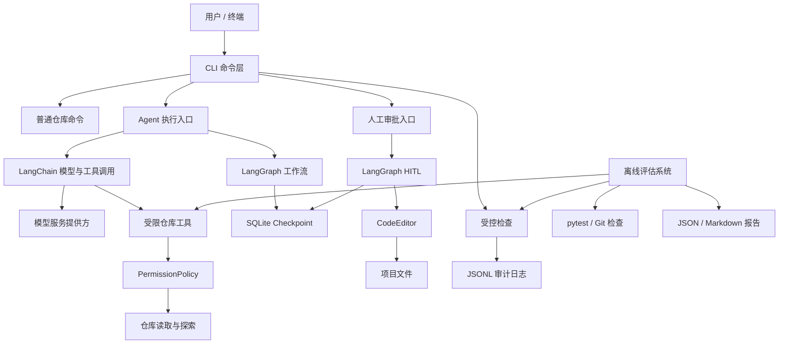
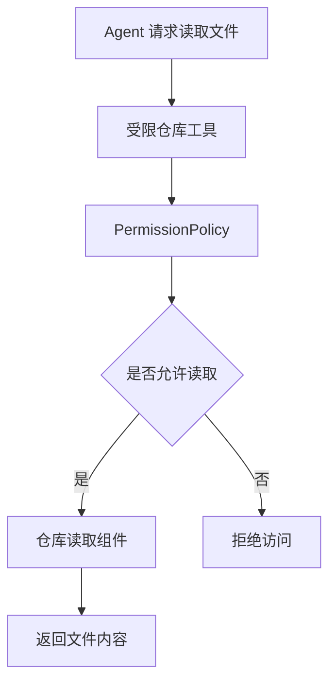
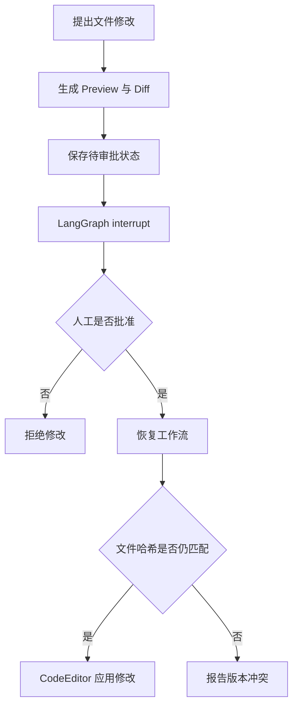
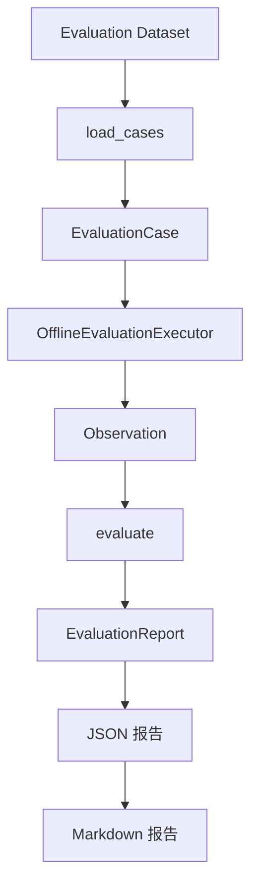

# AI Software Development Agent｜系统架构设计

## 1. 文档目的

本文档描述 AI Software Development Agent 的主要模块、职责边界、工作流、数据流以及安全机制。

目标是让开发者能够理解：

- 用户命令如何进入系统。
- LangChain 与 LangGraph 分别负责什么。
- Agent 如何访问代码仓库。
- 会话状态如何持久化。
- 文件修改为什么需要人工审批。
- 安全策略如何限制操作。
- 测试和离线评估如何验证系统。

本项目是学习型软件开发 Agent，当前架构并非完整生产级设计。

## 2. 系统整体架构



这是组件之间的**概念性关系图**，不是对当前每条代码调用链的精确复刻。

需要注意，不同 CLI 命令不一定经过同一个 Agent 工作流。

例如某些仓库检查命令可以直接调用本地工具，而不请求大模型。

## 3. 项目主要分层

### 3.1 CLI 接口层

主要位置：

```text
src/ai_software_dev_agent/cli.py

src/ai_software_dev_agent/commands/
```

职责：

- 解析命令行参数。
- 根据子命令选择功能。
- 校验用户提供的基础参数。
- 调用对应业务模块。
- 输出运行结果和错误信息。

CLI 层不应承担全部业务实现。

例如：

```text
用户输入命令
    ↓
CLI 解析参数
    ↓
调用业务模块
    ↓
接收结果
    ↓
向用户展示
```

将不同命令拆分到 `commands/`，可以降低单个 CLI 文件的复杂度。

### 3.2 Agent 与模型调用层

主要相关模块：

```text
agent.py
persistent_agent.py
```

职责：

- 初始化模型相关能力。
- 注册可使用的工具。
- 组织模型请求。
- 处理工具调用结果。
- 与 LangGraph 工作流进行集成。

LangChain 主要承担模型接入、消息与工具调用等能力。

LangGraph 主要承担多步骤执行、工作流状态、暂停恢复和持久化编排。

两者相互配合，但职责不同。

### 3.3 仓库工具层

负责向 Agent 提供项目文件探索能力。

典型操作：

```text
inspect_repository
read_repository_file
```

通过工具接口，模型能够提出读取文件的请求。

但模型不应直接拥有无限制的文件系统访问权限。

工具层需要检查路径与权限。

### 3.4 工作流层

LangGraph 用于组织多步骤执行。

它可以描述：

- 当前状态。
- 下一步操作。
- 工具调用后的处理。
- 是否需要人工批准。
- 执行何时结束。

相较于完全依赖普通 Python 函数调用，显式工作流更方便表达状态和执行过程。

但工作流也需要合理的终止条件和执行步数限制。

### 3.5 持久化层

主要相关模块：

```text
persistent_chat.py
persistent_agent.py
```

以及 SQLite Checkpoint。

职责：

- 保存多轮会话状态。
- 根据会话 ID 恢复上下文。
- 保存工作流暂停状态。
- 支持跨进程恢复审批。

注意：

模型对话历史持久化与业务数据库不是同一个概念。

当前 SQLite 主要用于 Agent 会话与工作流状态管理。

### 3.6 文件修改与人工审批层

主要相关模块：

```text
approval_workflow.py
edit_approval_workflow.py
```

以及 `CodeEditor` 组件。

职责：

- 生成文件修改预览。
- 展示 Diff。
- 暂停等待人工决定。
- 在批准后恢复工作流。
- 验证原文件版本。
- 应用修改或拒绝修改。

### 3.7 安全控制层

主要模块：

```text
security.py
secure_tools.py
restricted_commands.py
audit_log.py
```

分别负责：

- 文件访问权限。
- 受限仓库工具。
- 固定检查命令执行。
- 操作审计。

### 3.8 评估与报告层

主要模块：

```text
evaluation.py
evaluation_report.py
```

离线评估执行器：

```text
examples/day16_offline_evaluation.py
```

职责：

- 加载固定评估集。
- 执行真实本地工具。
- 收集实际观察结果。
- 对照预期进行评分。
- 统计成功率。
- 保存失败案例。
- 生成 JSON 和 Markdown 报告。

## 4. LangChain 与 LangGraph 的分工

### 4.1 LangChain 的作用

LangChain 为项目提供模型交互和工具调用的基础抽象。

例如：

```text
用户问题
    ↓
模型接收消息
    ↓
模型决定调用工具
    ↓
工具执行
    ↓
模型接收工具结果
```

对于仓库探索任务，模型可以使用注册好的仓库工具获取代码内容。

如果没有 LangChain，也可以自己封装模型 HTTP API 和工具调用协议。

但需要自行处理消息结构、工具描述、参数校验以及不同 Provider 的兼容问题。

### 4.2 LangGraph 的作用

LangGraph 更关注执行流程。

例如：

```text
初始化状态
    ↓
分析任务
    ↓
调用工具
    ↓
更新状态
    ↓
判断下一步
    ↓
完成或继续执行
```

对于需要暂停的任务：

```text
准备代码修改
    ↓
生成 Diff
    ↓
interrupt
    ↓
等待人工审批
    ↓
Command(resume=...)
    ↓
继续执行
```

LangGraph 的 Checkpoint 可以帮助保存和恢复工作流状态。

### 4.3 为什么不只使用普通函数？

普通 Python 函数当然也能完成简单步骤。

但当流程包括：

- 多步骤执行。
- 条件分支。
- 状态持久化。
- 工具调用循环。
- 人工审批。
- 跨进程恢复。

显式工作流能够让这些过程更清楚。

不过，引入工作流框架也增加了复杂度。

应当根据任务规模使用，而不是所有简单操作都必须经过 LangGraph。

## 5. 仓库访问安全设计

### 5.1 主要目标

限制 Agent 能够访问的文件范围。

例如允许读取指定项目中的：

```text
src/
tests/
docs/
README.md
pyproject.toml
```

同时拒绝：

- 工作区外路径。
- 不允许的绝对路径。
- 敏感配置文件。
- 不符合策略的隐藏文件。
- 通过符号链接绕过路径限制的访问。

实际允许范围以 `PermissionPolicy` 中的规则为准。

### 5.2 访问流程



### 5.3 为什么要把权限检查放进工具？

不能仅依赖模型提示词中的：

```text
不要读取敏感文件
```

模型仍可能产生不合规的工具调用请求。

因此必须由代码执行权限检查。

模型提出操作请求，不等于操作已被授权。

### 5.4 默认拒绝原则

对于未明确允许的文件访问或操作，安全策略应优先拒绝。

对于新增加的工具，也应该单独定义权限，而不是自动继承所有文件操作权限。

## 6. 受控检查与审计

### 6.1 RestrictedCheckRunner

该组件允许执行固定的项目检查操作。

例如：

```text
ruff_check
ruff_format_check
pytest
```

重点控制：

- 命令类型。
- 工作目录。
- 执行参数。
- 超时时间。
- 输出长度。
- 是否经过人工授权。

### 6.2 pytest 的特殊风险

pytest 并不只是读取测试文件。

它会真正执行 Python 代码。

因此，对来源不可信的项目运行 pytest，可能执行任意 Python 逻辑。

当前受控检查机制使用临时工作副本和有限制的环境设置，但并不是操作系统级安全沙箱。

不能因此认为运行任意第三方代码是安全的。

### 6.3 审计日志

使用 JSONL 记录操作事件。

每行保存一个 JSON 对象。

建议关注：

- 执行时间。
- 操作名称。
- 执行结果。
- 退出码。
- 失败原因。

面向用户的时间统一采用：

```text
YYYY-MM-DD HH:mm:ss.SSS
```

时区：

```text
Asia/Shanghai
```

审计日志有助于定位问题，但不能替代真正的访问控制。

## 7. HITL 文件修改流程

文件编辑审批是项目的重要能力之一。



### 7.1 为什么需要 Diff？

Diff 让开发者知道将要修改哪些代码。

相比直接覆盖整个文件，最小代码差异更容易审查。

### 7.2 为什么需要人工审批？

模型生成的修改方案不应自动等同于操作授权。

尤其是涉及重要业务逻辑时，应允许开发者在文件真正改变前进行确认。

### 7.3 为什么需要文件哈希？

准备修改和正式批准之间，文件可能已经发生变化。

如果仍然应用旧补丁，可能覆盖新的修改。

因此需要检查文件内容是否仍然符合准备审批时的版本。

如果不一致，应报告冲突，而不是继续强制覆盖。

### 7.4 状态恢复

通过 SQLite Checkpoint 保存待审批状态。

用户可以在后续进程中继续相同审批任务。

这与仅在一个 Python 函数里调用 `input()` 等待确认不同。

## 8. 离线评估系统

Day 16 建立了以下数据流：



### 8.1 为什么分离执行器和评分器？

执行器负责获取事实。

评分器负责比较预期与事实。

例如：

```text
expected = denied
actual = error
```

评分器应该判定失败。

不能因为操作没有成功读取文件，就直接认定安全规则生效。

### 8.2 Day 16 评估范围

固定评估集共十条任务。

包括：

- 三条合法文件读取。
- 三条访问拒绝。
- 三条业务测试。
- 一条 Git 工作区检查。

实际离线结果：

```text
10/10
100%
```

### 8.3 评估局限

当前评估主要覆盖固定的本地工具和业务场景。

没有完整评估：

- 模型自主分析的正确率。
- 未知 Bug 定位能力。
- 复杂多文件修改能力。
- 多轮自主开发稳定性。
- 任意仓库上的泛化能力。

因此，不能把离线评估成绩解释为真实自主软件开发成功率。

## 9. 持久化聊天设计

项目支持指定会话 ID，并通过 SQLite 保存上下文。

基本流程：

```text
用户输入
    ↓
根据 session/thread ID 取得状态
    ↓
模型处理当前消息
    ↓
调用工具（如需要）
    ↓
保存更新后的状态
    ↓
返回结果
```

### 9.1 为什么需要会话 ID？

因为多个会话需要彼此独立。

例如：

```text
session-A：分析项目 A
session-B：分析项目 B
```

如果两个会话共享相同状态，可能产生上下文污染。

### 9.2 为什么需要持久化？

普通内存状态在程序退出后就会消失。

使用 Checkpoint 可以让会话在重新启动后恢复。

### 9.3 当前输入方式的限制

CLI 使用单行读取方式时，将多行 Markdown 一次粘贴到终端，可能被拆成多次独立输入。

因此当前建议使用单行任务说明。

未来如果扩展多行输入，应明确设计输入结束规则，而不是简单修改提示词格式。

## 10. 测试策略

项目的测试分为不同层次。

### 10.1 单元测试

用于验证独立模块。

例如：

- 评估成功率计算。
- 路径校验。
- 参数校验。
- 报告格式化。
- 文件编辑预览逻辑。

### 10.2 离线集成测试

用于验证多个真实模块的协作。

例如：

- 真实仓库读取工具。
- 文件审批工作流。
- SQLite Checkpoint。
- 受控 pytest。
- 审计日志。

### 10.3 真实模型集成测试

用于验证实际模型是否能够：

- 理解任务。
- 正确选择工具。
- 处理工具返回。
- 生成合理的代码修改方案。

这一层受到 API 配额、服务可用性和模型能力影响。

因此不应该让所有常规测试都依赖真实模型 API。

## 11. GitHub Actions CI

工作流文件：

```text
.github/workflows/ci.yml
```

主要检查：

```text
安装 Python
    ↓
安装项目依赖
    ↓
Ruff Check
    ↓
Ruff Format Check
    ↓
pytest
```

CI 的目的：

- 防止明显的代码质量问题进入主分支。
- 自动发现旧功能的测试回归。
- 验证项目在新环境中的安装与运行情况。

CI 不会自动证明 Agent 的真实推理质量。

当前 CI 不直接运行依赖独立实验仓库的 Day 16 评估脚本。

## 12. 主要工程限制与未来改进方向

目前仍需要逐步完善：

1. 更严格的操作系统级执行隔离。
2. 更稳定的模型 Provider 管理。
3. CLI 多行任务输入。
4. 更好的工具调用终止与错误处理。
5. 更丰富的真实 Agent 任务评估。
6. 更完善的日志与可观测性。
7. 大型项目中的多文件修改能力。
8. 实际发布和部署策略。

这些是后续可能的改进方向，不代表 Day 17 必须全部实现。

## 13. 架构总结

本项目采用了相对清晰的模块职责划分：

- CLI 负责用户交互。
- LangChain 负责模型与工具调用。
- LangGraph 负责工作流与状态。
- 仓库工具负责项目探索。
- PermissionPolicy 负责访问限制。
- CodeEditor 负责文件修改。
- HITL 负责人工审批。
- SQLite 负责持久化。
- pytest、Ruff 和评估模块负责质量验证。
- GitHub Actions 负责持续集成。

最重要的工程原则是：

**模型负责提出建议和选择能力，工具负责执行具体操作，权限策略负责限制行为，人工审批负责关键授权，自动化测试负责验证结果。**

这些职责不能相互混淆。

本架构文档应随着实际实现演进而更新，避免文档与代码脱节。