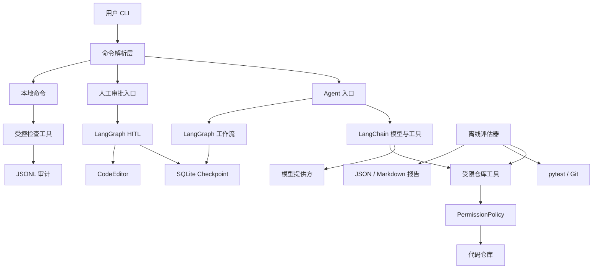
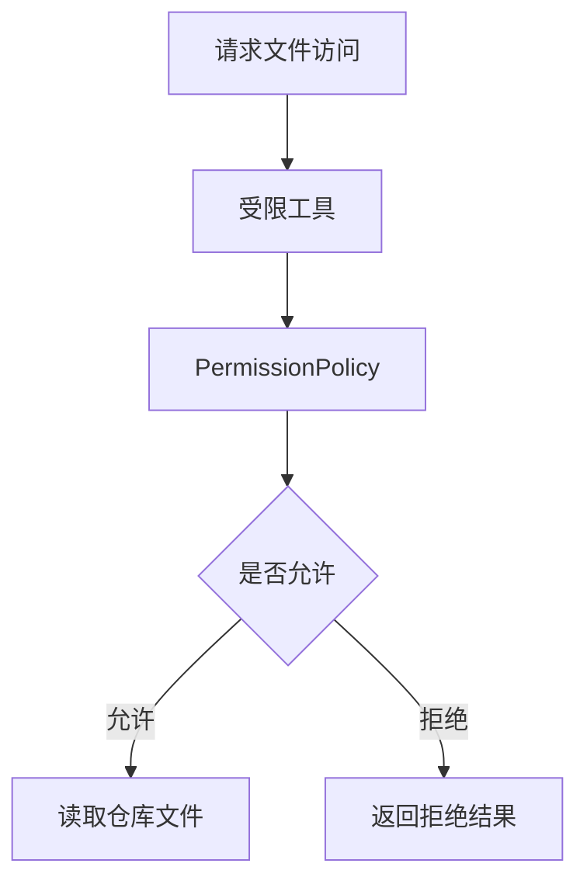
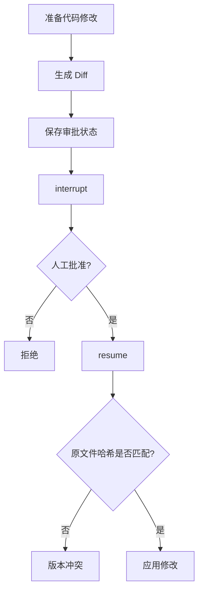
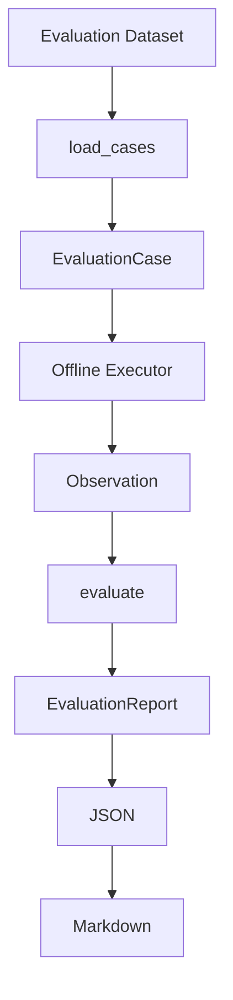

# Day 17｜工程完善与 CI（Continuous Integration）

**所属项目：** AI Software Development Agent

**学习计划：** 18 天工程开发计划 · Day 17

**学习主题：** 工程完善、项目文档、GitHub Actions、持续集成与 Pull Request

**环境：** Python 3.13、Git、GitHub、pytest、Ruff

**开发方式：** 手动编码、vim 编辑、离线自动化测试、Git 功能分支

**真实模型 API 请求：** 0 次

**GitHub CI 最终状态：** 待实际远程验收后填写

---

# 一、今天的目标

Day 16 已经完成 Agent 的离线评估框架，建立了十条固定评估任务和 JSON、Markdown 评估报告。

Day 17 不继续增加新的 Agent 业务功能，而是完善项目的工程质量和交付条件。

主要目标：

1. 检查已有项目结构和依赖配置。
2. 使用 GitHub Actions 自动运行 pytest、Ruff。
3. 完善项目 README。
4. 编写系统架构文档。
5. 通过功能分支和 Pull Request 审查工程变更。
6. 在 GitHub 的新环境中验证自动化检查。
7. 整理失败案例和 Debug 经验。
8. 完成项目文档与 Git 提交。

本日尽量保持已有 Python 模块和公共接口不变，不进行缺乏明确收益的大规模重构。

---

# 二、CI 的核心概念

## 2.1 什么是 CI？

CI 是 Continuous Integration（持续集成）。

它的核心思想是：开发者持续将代码集成到共享仓库，并通过自动化检查尽早发现问题。

之前的流程：

```text
编写代码
    ↓
手动运行 pytest
    ↓
手动运行 Ruff
    ↓
Git Commit
    ↓
Git Push
```

增加 CI 后：

```text
编写代码
    ↓
本地 pytest / Ruff
    ↓
Git Commit / Push
    ↓
GitHub 自动创建 Runner
    ↓
安装项目与依赖
    ↓
Ruff Check
    ↓
Ruff Format Check
    ↓
pytest
    ↓
显示通过或失败
    ↓
人工审查与合并
```

CI 不是替代本地测试，而是在远程提供一次独立检查。

## 2.2 为什么本地通过还需要 CI？

本地环境可能已经安装了许多依赖，而 `pyproject.toml` 并没有完整声明。

例如：

```text
本地：
已经安装 pytest-asyncio
测试通过

GitHub：
全新 Python 环境
缺少 pytest-asyncio
测试失败
```

这种失败暴露的是项目环境可复现性问题。

CI 可以帮助发现：

- 依赖遗漏。
- Python 版本不兼容。
- Linux 与 macOS 的路径差异。
- 代码格式问题。
- 测试回归。
- 未声明的环境依赖。

## 2.3 CI 与 CD 的区别

CI：持续集成，重点是代码检查、构建和测试。

CD：持续交付或持续部署，重点是把经过验证的软件交付或部署到目标环境。

Day 17 只实现 CI，不自动发布软件，不部署服务，也不运行需要真实大模型 API 的测试。

---

# 三、准备开发环境

## 3.1 设置项目路径

```bash
AGENT_ROOT="$HOME/Documents/公子路的长期成长计划/02-AI-Agent-Engineering/ai-software-development-agent"

cd "$AGENT_ROOT"

source .venv/bin/activate
```

确认环境：

```bash
which python
python --version
python -m pytest --version
python -m ruff --version
```

预期 Python 为 3.13。

## 3.2 检查 Git 工作区

```bash
git status --short
git branch --show-current
git log -1 --oneline
```

Day 16 的内容应当已经完成提交。

不要将 Day 16 未完成的代码混入 Day 17。

## 3.3 检查项目文件结构

```bash
find src/ai_software_dev_agent \
  -type f -name "*.py" | sort

find tests \
  -type f -name "test_*.py" | sort

find docs \
  -maxdepth 2 -type f | sort

find .github/workflows \
  -maxdepth 1 -type f | sort
```

为什么使用 `find`？

因为它可以递归检查目录，输出实际存在的文件，适合工程审查。

本机不依赖 `rg`，全文查找使用 `grep`。

## 3.4 检查项目依赖

```bash
grep -n -E \
  '^\[project\]|^\[build-system\]|requires-python|dependencies|pytest|ruff' \
  pyproject.toml
```

检查当前环境是否有依赖冲突：

```bash
python -m pip check
```

如果输出：

```text
No broken requirements found.
```

表示当前已安装环境没有发现依赖冲突。

但它并不能证明 `pyproject.toml` 已完整声明所有测试依赖。

后续 GitHub 全新环境安装才是更关键的验证。

---

# 四、创建功能分支

执行：

```bash
git switch main
git status --short
git switch -c feat/day17-engineering-ci
```

确认：

```bash
git branch --show-current
```

预期：

```text
feat/day17-engineering-ci
```

功能分支的价值：

- 不在 `main` 上直接开展未完成开发。
- 将工程变更集中管理。
- 便于进行 Pull Request。
- 方便检查文件 Diff。
- 允许 CI 通过后再合并。

本日所有工程完善内容都在该分支中完成。

---

# 五、创建 GitHub Actions 工作流

## 5.1 检查已有文件

```bash
find .github/workflows \
  -maxdepth 1 -type f -print
```

如果已经存在 CI，不直接覆盖，应先审查原有配置。

## 5.2 创建目录与文件

```bash
mkdir -p .github/workflows
touch .github/workflows/ci.yml
vim .github/workflows/ci.yml
```

Vim 基本使用：

```text
i      进入插入模式
Esc    返回普通模式
:w     保存
:wq    保存并退出
:q!    放弃修改并退出
```

## 5.3 完整 `ci.yml`

文件：

`.github/workflows/ci.yml`

```yaml
# Day 17：AI Software Development Agent 持续集成

name: Python CI

# 监听 main 的 push、PR，以及手动运行。
on:
  push:
    branches:
      - main

  pull_request:
    branches:
      - main

  workflow_dispatch:

# 最小权限：只读取仓库源码。
permissions:
  contents: read

jobs:
  quality-and-tests:
    name: Python 3.13 / pytest / Ruff

    # GitHub 提供的 Linux Runner。
    runs-on: ubuntu-latest

    # 防止异常任务无限执行。
    timeout-minutes: 20

    env:
      PYTHONUTF8: "1"
      PYTHONDONTWRITEBYTECODE: "1"
      TZ: Asia/Shanghai

    steps:
      # 下载当前仓库源码。
      - name: Checkout repository
        uses: actions/checkout@v7
        with:
          persist-credentials: false

      # 安装 Python 3.13。
      - name: Set up Python 3.13
        uses: actions/setup-python@v7
        with:
          python-version: "3.13"

      # 打印版本，方便排查运行环境。
      - name: Verify Python version
        run: python --version

      # 安装项目及检查工具。
      - name: Install dependencies
        run: |
          python -m pip install --upgrade pip
          python -m pip install -e . pytest ruff

      # Ruff 静态检查。
      - name: Ruff lint
        run: python -m ruff check .

      # Ruff 格式检查。
      - name: Ruff format
        run: python -m ruff format --check .

      # 完整自动化测试。
      - name: Run pytest
        run: python -m pytest -v
```

**重要：** 这份安装命令假定当前项目通过 `pip install -e .` 能正确安装运行所需依赖。如果项目已有 `[project.optional-dependencies]` 的 `dev` 分组，应使用实际定义的开发依赖安装方式。不要为了让 CI 运行而删除测试或掩盖依赖缺失。

## 5.4 解释 `on`

```yaml
on:
  push:
    branches:
      - main

  pull_request:
    branches:
      - main

  workflow_dispatch:
```

`on` 决定工作流什么时候触发。

`push`：

代码推送到 `main` 后触发。

`pull_request`：

创建或更新目标分支为 `main` 的 PR 时触发。

`workflow_dispatch`：

支持手动触发（通常需要工作流已经存在于默认分支）。

需要注意：当前配置没有针对所有功能分支的 `push` 事件，因此单独推送 `feat/day17-engineering-ci` 不一定会触发 CI；创建指向 `main` 的 PR 才是主要验证入口。

## 5.5 解释 `permissions`

```yaml
permissions:
  contents: read
```

只给予读取仓库的权限。

本日 CI 不需要：

- 向仓库推送代码。
- 修改 Issues。
- 修改 Pull Request。
- 自动发布 Release。

因此没有必要授予写权限。

这体现了最小权限原则。

## 5.6 解释 Job 与 Step

一个 Workflow 可以包含多个 Job。

这里定义一个：

```yaml
jobs:
  quality-and-tests:
```

Job 运行在 Ubuntu Runner 中。

内部的 `steps` 按顺序执行：

```text
Checkout
   ↓
Setup Python
   ↓
Verify Version
   ↓
Install Dependencies
   ↓
Ruff Lint
   ↓
Ruff Format
   ↓
pytest
```

当前采用单 Job，结构简单，便于学习和排错。

如果未来需要多个 Python 版本，可以再考虑矩阵测试，不属于今天必须实现的范围。

## 5.7 解释 GitHub Actions 版本

```yaml
uses: actions/checkout@v7
```

`v7` 是 Checkout Action 的版本。

```yaml
uses: actions/setup-python@v7
```

`v7` 是 Setup Python Action 的版本。

```yaml
python-version: "3.13"
```

`3.13` 才是本次使用的 Python 版本。

不要混淆 Action 版本与 Python 解释器版本。

## 5.8 解释 `persist-credentials: false`

这个选项用于避免将 Checkout 使用的认证信息持久保存在仓库的 Git 配置中。

本次 CI 仅需读取源码，不需要在 Runner 内执行 Git Push。

因此没有必要保留推送凭据。

## 5.9 解释安装命令

```bash
python -m pip install --upgrade pip
python -m pip install -e . pytest ruff
```

`pip install -e .` 表示可编辑安装当前 Python 项目。

`pytest` 是自动化测试工具。

`ruff` 是静态检查和代码格式化工具。

必须特别注意：

**本地 `.venv` 已经安装了某个包，不代表 CI 新环境也会自动拥有该包。**

如果 CI 出现依赖缺失，应该检查 `pyproject.toml`，将真正需要的依赖声明完整。

## 5.10 为什么 CI 不执行自动修复？

CI 使用：

```bash
python -m ruff check .
python -m ruff format --check .
```

而不是：

```bash
python -m ruff check . --fix
python -m ruff format .
```

因为 CI 的任务是检查并报告问题。

代码修改应由开发者完成，然后重新提交。

如果 CI 自动修复后仍返回成功，可能掩盖仓库中原本存在的问题。

## 5.11 为什么 CI 不调用 OpenRouter？

我们已经在 Day 14～Day 16 遇到过：

- 模型下线导致 404。
- 免费请求额度耗尽导致 429。
- 多轮工具调用消耗较多请求。
- 不同模型的工具调用能力存在差异。

因此常规 CI 应优先使用 Mock、Fake、固定测试数据与离线工具。

真实模型集成测试单独安排，并明确它可能产生费用或遇到限流。

---

# 六、本地模拟 CI

在 GitHub 运行之前，先执行与 CI 对应的本地检查：

```bash
cd "$AGENT_ROOT"

python -m pytest -v

python -m ruff check .

python -m ruff format --check .
```

这三项检查在 Day 17 第一阶段已验证通过。

注意本地的 Mac 环境与 GitHub 的 Ubuntu 环境仍有差异，因此最终还必须检查远程运行结果。

---

# 七、工程结构与模块职责审查

本次不做大规模重构，主要确认已有职责是否合理划分。

## 7.1 CLI 层

主要位置：

```text
src/ai_software_dev_agent/cli.py
src/ai_software_dev_agent/commands/
```

负责：

- 命令行参数解析。
- 命令分发。
- 用户输入与结果输出。
- 调用具体业务模块。

不应把所有模型请求、文件操作和工作流逻辑都堆进 `cli.py`。

## 7.2 Agent 层

主要相关模块：

```text
agent.py
persistent_agent.py
persistent_chat.py
```

负责模型与工具调用、Agent 工作流和会话持久化等。

LangChain 主要为模型交互与工具调用提供抽象。

LangGraph 主要负责有状态的流程执行、暂停、恢复与 Checkpoint。

## 7.3 工具与安全层

主要模块：

```text
security.py
secure_tools.py
restricted_commands.py
audit_log.py
```

负责：

- 检查允许访问的路径。
- 限制仓库工具的能力。
- 执行预定义检查。
- 保存审计日志。

特别注意：受控执行器不是 OS 级沙箱，不能把任意不可信 Python 测试代码当成安全代码执行。

## 7.4 文件修改与审批层

主要相关模块：

```text
approval_workflow.py
edit_approval_workflow.py
```

文件修改遵循：

```text
预览修改
   ↓
生成 Diff
   ↓
保存审批状态
   ↓
等待人工批准
   ↓
验证文件版本
   ↓
应用或拒绝修改
```

这样避免让模型在未经批准时直接写入重要源码。

## 7.5 评估层

主要模块：

```text
evaluation.py
evaluation_report.py
examples/day16_offline_evaluation.py
```

职责：

- 读取固定评估集。
- 执行离线任务。
- 比较预期与实际。
- 统计成功率。
- 保存失败案例。
- 生成 JSON、Markdown 报告。

Day 16 的固定离线评估为 10/10。

这不等于真实模型自主开发成功率。

---

# 八、完善 README.md

## 8.1 查看原有文件

```bash
sed -n '1,260p' README.md
```

编辑：

```bash
vim README.md
```

README 需要解决的问题：

**第一次接触项目的人，能否理解项目定位、如何安装、怎样运行和如何验证？**

README 不需要复制每一个 Python 文件，但应提供明确的入口。

## 8.2 README 完整参考内容

以下为 Day 17 整理的完整 README 参考版本。实际仓库中已经存在且经过验证的具体 CLI 用法，应优先保留并与此版本合并。

````markdown
# AI Software Development Agent

一个基于 **Python、LangChain 和 LangGraph** 构建的 AI 软件开发智能体学习项目。

项目围绕 Python 工程开发，逐步实现仓库探索、开发任务规划、工具调用、持久化会话、代码编辑、人工审批、安全限制与自动化评估。

> 当前定位：个人工程学习与实践项目，并非生产级自主编程系统。

## 1. 项目目标

- 理解和探索本地 Python 仓库。
- 根据需求生成开发任务计划。
- 使用 LangChain 模型与工具调用能力。
- 使用 LangGraph 编排有状态工作流。
- 支持多轮对话及 SQLite 会话恢复。
- 预览文件修改并经过人工审批后应用。
- 限制文件访问和代码检查操作。
- 使用 pytest、Ruff 和离线评估验证工程能力。

## 2. 主要功能

### 仓库探索

提供文件结构检查和受限仓库读取工具，供开发任务分析使用。

### 开发任务规划

支持通过已配置的模型生成结构化开发计划。

实际效果依赖模型能力、外部服务可用性和任务复杂度。

### Agent 工作流

使用 LangChain 与 LangGraph 组织模型、工具和状态。

多步骤复杂任务仍可能受到工具调用次数和执行限制影响。

### 持久化会话

使用 SQLite Checkpoint 保存会话状态，支持按会话 ID 恢复上下文。

### 人工审批

文件修改之前生成 Diff，并等待人工确认。

结合 LangGraph 的 interrupt/resume、SQLite Checkpoint 与 CodeEditor 完成审批和应用。

### 安全控制

通过 PermissionPolicy 和受限仓库工具限制文件读取。

通过 RestrictedCheckRunner 运行预定义检查，并使用 JSONL 记录审计事件。

受控执行不等同于操作系统级安全沙箱。

### 离线能力评估

Day 16 建立了十条固定评估任务，覆盖仓库读取、权限拒绝、业务回归及 Git 状态检查。

当前离线评估结果为 10/10。

该成绩不代表模型自主编程成功率。

## 3. 技术栈

| 技术 | 用途 |
|---|---|
| Python 3.13 | 开发语言 |
| LangChain | 模型与工具调用 |
| LangGraph | 工作流和状态管理 |
| SQLite | 持久化会话和审批 |
| Pydantic | 结构化数据校验 |
| pytest | 自动化测试 |
| Ruff | 代码质量与格式检查 |
| Git / GitHub | 版本管理 |
| GitHub Actions | 持续集成 |

依赖版本以 `pyproject.toml` 为准。

## 4. 环境安装

建议使用 Python 3.13。

克隆项目后，进入仓库根目录。

创建虚拟环境：

```bash
python3.13 -m venv .venv
source .venv/bin/activate
```

安装项目：

```bash
python -m pip install -e .
```

安装测试和检查工具：

```bash
python -m pip install pytest ruff
```

如果当前项目已声明完整开发依赖组，应使用实际定义的安装方式。

## 5. CLI 使用

查看帮助：

```bash
ai-dev-agent --help
```

环境检查：

```bash
ai-dev-agent doctor
```

聊天功能：

```bash
ai-dev-agent chat --help
```

开发 Agent：

```bash
ai-dev-agent agent-workflow --help
```

人工审批：

```bash
ai-dev-agent edit-approval --help
```

上述命令用于查看接口，不会直接发起模型推理。实际运行参数以当前 CLI 帮助为准。

## 6. 模型配置

真实模型调用需要配置对应 Provider 的：

- API Key。
- API Base URL。
- 模型 ID。

免费模型可能下线或触发速率、日额度限制。

不要将 API Key、`.env` 或敏感配置上传到 GitHub。

普通单元测试和 CI 优先采用离线验证。

## 7. 自动化测试

```bash
python -m pytest -v
```

Ruff 检查：

```bash
python -m ruff check .
python -m ruff format --check .
```

需要自动修复时：

```bash
python -m ruff check . --fix
python -m ruff format .
```

修复后必须重新执行全部检查。

## 8. 离线 Agent 评估

评估集：

`evaluations/day16_cases.json`

执行器：

`examples/day16_offline_evaluation.py`

使用：

```bash
python examples/day16_offline_evaluation.py \
  --project /path/to/trusted-lab \
  --cases evaluations/day16_cases.json \
  --output /tmp/day16-report.json
```

当前评估集针对 Day 14/15 的订单结算实验项目，不是通用的任意仓库评估集。

历史评估报告保存在 `evaluations/reports/`。

## 9. 持续集成

GitHub Actions 配置：

`.github/workflows/ci.yml`

工作流主要执行：

- Python 环境初始化。
- 项目依赖安装。
- Ruff Check。
- Ruff Format Check。
- pytest。

不向普通 CI 注入 OpenRouter API Key。

Day 16 的完整离线评估需要独立实验仓库，当前默认 CI 不直接执行该实验脚本。

## 10. 工程实战

**Day 14：Bug 修复**

通过独立订单结算实验，复现优惠码错误影响运费的问题，使用最小修改和人工审批完成修复。

**Day 15：功能开发**

新增 `FREESHIP` 免运费优惠码，使用测试先行、审批、回归测试及 GitHub Pull Request 交付功能。

这些实战中的离线 Demo 不代表真实大模型已经独立完成全部开发流程。

## 11. 项目文档

- [系统架构](docs/Architecture.md)
- [Day 16 能力评估](docs/Day16-Agent-Evaluation.md)
- [Day 17 工程完善与 CI](docs/Day17-Engineering-and-CI.md)

## 12. 当前限制

- 模型表现受 Provider 与 API 配额影响。
- 多步骤 Agent 可能发生工具循环和步数限制。
- CLI 单行输入不适合直接粘贴复杂多行任务。
- 受控执行器不是完整安全沙箱。
- 离线评估任务数量有限，不能代表广泛真实开发场景。
- 大模型自主完成开发任务的稳定性仍需进一步验证。

## 13. 项目定位

本项目用于学习、实践和展示 Python 工程开发、Agent 工作流、工具集成、安全控制和自动化测试。

项目不宣称已经达到生产级自主软件开发系统的能力。
````

## 8.3 README 的重要原则

README 应当：

- 介绍已经实现的功能。
- 提供可验证的命令。
- 告知必要的环境和依赖。
- 明确限制与风险。
- 链接架构文档。

不应该：

- 编造尚未实现的能力。
- 在 README 中加入真实密钥。
- 把离线 Demo 描述为大模型自主开发成功。
- 为了简化 README 而删除项目已有的真实使用方法。

---

# 九、创建架构文档

## 9.1 创建与编辑

```bash
mkdir -p docs
touch docs/Architecture.md
vim docs/Architecture.md
```

如果文件已经存在，先检查并整合，不重复创建不同版本。

## 9.2 `docs/Architecture.md` 完整参考内容

````markdown
# AI Software Development Agent｜系统架构

## 1. 文档目标

本文描述项目的主要模块、职责边界、执行流程、持久化机制、安全措施和测试体系。

帮助开发者理解用户命令如何进入系统，以及模型、工具、工作流、审批和检查如何协作。

## 2. 总体架构



这是概念架构图，不代表所有命令都需要经过大模型或完全相同的执行链路。

## 3. CLI 接口层

主要位置：

- `cli.py`
- `commands/`

职责：

- 解析用户参数。
- 分发命令。
- 调用对应模块。
- 展示结果和错误。

具体业务逻辑不应全部放在 CLI 入口中。

## 4. Agent 层

主要位置：

- `agent.py`
- `persistent_agent.py`
- `persistent_chat.py`

职责：

- 接入模型服务。
- 注册工具。
- 组织开发 Agent 工作流。
- 管理多轮会话和持久化状态。

### LangChain 的职责

主要提供模型交互、消息和工具调用等抽象。

### LangGraph 的职责

组织状态、流程执行、条件跳转、Checkpoint 和人工审批。

普通 Python 函数也能实现简单步骤，但复杂的有状态工作流需要更加明确的控制与恢复机制。

## 5. 仓库工具

典型工具：

- `inspect_repository`
- `read_repository_file`

负责向 Agent 提供仓库文件结构及受限文件读取。

工具不应让模型直接获得无限制的文件系统访问权限。

## 6. 权限策略

主要模块：

- `security.py`
- `secure_tools.py`

权限检查流程：



安全设计原则：

- 限制工作区边界。
- 拒绝路径越界。
- 拒绝不允许的绝对路径。
- 限制敏感文件读取。
- 对未明确允许的操作默认拒绝。

具体规则以实际 PermissionPolicy 实现为准。

## 7. LangGraph 状态与 Checkpoint

使用 SQLite 保存部分工作流状态。

主要用途：

- 多轮会话。
- 指定会话 ID。
- 跨进程恢复。
- 人工审批暂停状态。

会话状态持久化不等于普通业务数据库。

## 8. HITL 代码修改流程

主要相关模块：

- `approval_workflow.py`
- `edit_approval_workflow.py`
- CodeEditor 相关组件



为什么需要 Diff：

让开发者能够看到修改内容。

为什么需要人工审批：

模型提出修改不等于获得写入授权。

为什么需要 SHA-256 校验：

避免将过期修改应用到已经变化的文件上。

## 9. 受控检查与审计

主要模块：

- `restricted_commands.py`
- `audit_log.py`

可执行预定义检查，例如：

- `ruff_check`
- `ruff_format_check`
- `pytest`

执行时需关注：

- 命令白名单。
- 工作目录。
- 超时。
- 输出长度。
- 审批要求。
- 审计记录。

重要限制：

运行 pytest 会执行 Python 代码。

临时目录和受限环境变量不等于操作系统级安全沙箱。

不应直接运行来源不可信的代码。

## 10. 评估系统

主要模块：

- `evaluation.py`
- `evaluation_report.py`
- `examples/day16_offline_evaluation.py`

数据流：



职责划分：

- Dataset 定义预期。
- Executor 获取真实观察。
- Evaluation 比较结果。
- Report 汇总和展示。

Day 16 实际评估十条固定离线任务，全部通过。

该结果不代表任意真实模型开发任务的成功率。

## 11. 测试体系

### 单元测试

验证独立模块，包括：

- 数据校验。
- 评估统计。
- 文件预览。
- 权限判断。
- 报告生成。

### 离线集成测试

验证实际模块之间的协作，例如：

- 仓库工具。
- SQLite Checkpoint。
- 审批流程。
- 受控命令。
- 评估执行器。

### 真实模型集成测试

验证模型能否正确理解任务、使用工具并生成修改。

本类测试可能受到模型服务、额度和稳定性的影响，因此不应混入所有常规 CI 检查。

## 12. CI 架构

工作流：

`.github/workflows/ci.yml`

流程：

```text
Git Push / PR
    ↓
GitHub Ubuntu Runner
    ↓
Python 3.13
    ↓
安装依赖
    ↓
Ruff Check
    ↓
Ruff Format Check
    ↓
pytest
```

CI 负责自动发现工程质量和回归问题。

CI 通过不意味着大模型的自主编程能力已得到完整验证。

## 13. 当前工程限制

- 模型 Provider 可用性不稳定。
- 免费模型可能限制请求次数。
- 复杂工具调用可能出现循环或达到步数限制。
- CLI 暂不适合大段多行粘贴输入。
- 执行隔离不属于生产级安全沙箱。
- 固定评估集覆盖范围有限。
- 真实自主开发成功率尚未充分验证。

## 14. 架构设计原则总结

1. CLI 负责交互。
2. 模型负责产生建议和选择工具。
3. LangChain 负责模型与工具抽象。
4. LangGraph 负责状态与流程。
5. 工具负责实际操作。
6. 权限策略负责约束操作。
7. HITL 负责关键授权。
8. 自动化测试和评估负责验证结果。

最重要的原则：

**模型建议、工具执行、权限控制、人工授权和结果验证必须保持清晰的职责边界。**
````

## 9.3 架构文档的意义

README 回答：

**项目是什么，如何使用？**

Architecture 回答：

**系统由什么组成，为什么这样设计？**

每日学习文档回答：

**今天具体创建了什么、为什么这样写、怎么测试和排错？**

这三种文档的职责不同，因此不应该全部堆在 README 中。

---

# 十、文档一致性检查

执行：

```bash
test -f README.md
test -f docs/Architecture.md
test -f .github/workflows/ci.yml
```

检查关键模块：

```bash
grep -n -E \
  'LangChain|LangGraph|SQLite|HITL|pytest|Ruff' \
  README.md docs/Architecture.md
```

核对实际模块：

```bash
find src/ai_software_dev_agent \
  -type f -name "*.py" | sort
```

核对 CLI：

```bash
ai-dev-agent --help
ai-dev-agent chat --help
ai-dev-agent edit-approval --help
```

说明：

架构图为概念关系图，不应当被理解为每一条真实 Python 函数调用路径。

如果文档中某个模块名称与当前代码不同，应修正文档。

不要为了文档看起来完整而重构已经正常工作的模块。

---

# 十一、第三阶段：GitHub CI 真实运行

前两个阶段只完成了本地代码和文档。

真正的远程验收需要 Git Push 和 PR。

## 11.1 保存学习文档

文件：

`docs/Day17-Engineering-and-CI.md`

使用：

```bash
vim docs/Day17-Engineering-and-CI.md
```

本学习文档保存后，先执行本地校验，再提交 Git。

## 11.2 本地 pytest

```bash
python -m pytest -v
```

必须保留并执行全部现有测试。

## 11.3 Ruff

```bash
python -m ruff check .
python -m ruff format --check .
```

如果失败，先根据实际输出修复。

不要在 CI 中配置忽略错误来制造绿色状态。

## 11.4 检查 Git 修改范围

```bash
git status --short
git diff --check
git diff --stat
```

检查工作流：

```bash
sed -n '1,220p' .github/workflows/ci.yml
```

本次主要变更应集中在：

```text
.github/workflows/ci.yml
README.md
docs/Architecture.md
docs/Day17-Engineering-and-CI.md
```

如果存在其他改动，先确认原因。

## 11.5 Git 暂存

```bash
git add \
  .github/workflows/ci.yml \
  README.md \
  docs/Architecture.md \
  docs/Day17-Engineering-and-CI.md
```

检查：

```bash
git diff --cached --stat
git diff --cached --check
git diff --cached --name-only
```

## 11.6 Git Commit

```bash
git commit -m "ci: add GitHub Actions and engineering docs"
```

检查当前分支：

```bash
git branch --show-current
```

应当是：

```text
feat/day17-engineering-ci
```

## 11.7 推送功能分支

```bash
git push -u origin feat/day17-engineering-ci
```

注意：

推送 `.github/workflows/ci.yml` 可能需要具有相应 Workflows 写入权限的 GitHub 凭据。

如果遇到权限拒绝，应检查当前 Token 的仓库和 Workflows 权限，而不是删除 CI 文件。

## 11.8 创建 Pull Request

打开 GitHub 上的 AI Software Development Agent 仓库。

选择：

**Compare & pull request**

设置：

```text
base: main

compare: feat/day17-engineering-ci
```

PR 标题：

```text
ci: add Python CI and engineering documentation
```

PR 描述建议包含：

- 新增 Python 3.13 GitHub Actions CI。
- 运行 pytest、Ruff Check、Ruff Format。
- 完善 README。
- 增加 Architecture 文档。
- 不引入真实模型 API 依赖。
- 本地测试结果。
- 远程 CI 验收结果（待运行后确认）。

## 11.9 查看 GitHub Actions

创建 PR 后，检查 PR 的 **Checks** 区域。

也可以进入仓库的 **Actions** 标签，选择 `Python CI` 工作流。

预期步骤：

```text
Checkout repository
Set up Python 3.13
Verify Python version
Install dependencies
Ruff lint
Ruff format
Run pytest
```

只有这些步骤完成并显示成功，才能认为远程 CI 验收通过。

如果工作流没有触发，先检查：

- PR 目标分支是否为 `main`。
- `ci.yml` 是否已经推送到 PR 分支。
- Actions 是否被仓库设置禁用。
- YAML 是否能够被 GitHub 解析。
- 是否需要运行批准。

## 11.10 如果 CI 失败

先打开红色 Job，再点击失败步骤查看日志。

不要根据最后一行 `Process completed with exit code 1` 就下结论，应找到前面的具体错误。

如果是依赖问题，修复项目配置或 CI 安装方式。

如果是 Ruff 问题，在本地修复对应文件。

如果是 pytest 问题，确认是否为真实回归、环境差异或缺少依赖。

修复后重新执行本地测试，然后提交新的修复 Commit，并推送相同功能分支。

GitHub 将针对新的提交重新运行 PR 检查。

不需要为了修复 CI 失败而创建第二个 PR。

---

# 十二、常见 CI 问题与 Debug

## 12.1 `ModuleNotFoundError`

示例：

```text
ModuleNotFoundError: No module named 'pytest_asyncio'
```

可能原因：

CI 环境缺少项目测试所需的依赖。

检查：

```bash
grep -n -E \
  'pytest|asyncio|dependencies' \
  pyproject.toml
```

如果项目实际需要 `pytest-asyncio`，应在开发依赖配置中明确声明，并让 CI 安装该依赖。

不能只因为本地虚拟环境已经安装，就假设 CI 自动拥有。

## 12.2 `pip install -e .` 失败

可能原因：

- `pyproject.toml` 配置不完整。
- 项目构建后端依赖缺失。
- 依赖版本冲突。
- Python 版本限制。
- 网络下载问题。

本地检查：

```bash
python -m pip install -e .
python -m pip check
```

不过本地成功并不一定说明 GitHub 安装环境也相同。

真正的错误以 CI 安装步骤的日志为准。

## 12.3 Ruff lint 失败

运行：

```bash
python -m ruff check .
```

需要自动修复时：

```bash
python -m ruff check . --fix
```

然后重新检查。

## 12.4 Ruff format 失败

运行：

```bash
python -m ruff format --check .
```

确有需要时：

```bash
python -m ruff format .
```

然后重新运行：

```bash
python -m pytest -v
python -m ruff check .
python -m ruff format --check .
```

## 12.5 `FileNotFoundError`

如果错误中包含本机路径，例如：

```text
/Users/.../Documents/...
```

需要检查测试是否依赖了开发者个人的绝对路径。

CI 使用 Linux，不能直接访问 Mac 的本地目录。

测试应尽量使用：

- `tmp_path`。
- 项目相对路径。
- 临时目录。
- 确定性的测试数据。

## 12.6 真实 API 错误

如果 CI 出现：

```text
401 Unauthorized
429 Rate Limit
```

首先检查是不是某个测试实际调用了真实模型 API。

普通 CI 应优先离线运行，不应靠个人 API Key 保证常规测试通过。

不能通过删除业务测试来掩盖问题。

应该合理区分离线自动化测试和真实模型集成测试。

## 12.7 Push Workflow 被拒绝

可能出现：

```text
refusing to allow a Personal Access Token
to create or update workflow
```

这种情况涉及 GitHub Token 权限。

应检查 Token 是否具有相应仓库访问权，以及 Workflows 写入权限。

如果使用 Fine-grained Token，检查对应仓库的 Workflows 权限是否设置为 Read and write。

不需要为了绕过权限限制删除 `ci.yml`。

## 12.8 GitHub Actions 没有出现运行记录

检查：

```bash
git branch --show-current
git remote -v
git log -1 --oneline
```

然后确认 GitHub 上的 PR 实际包含 `.github/workflows/ci.yml`。

在本次工作流配置下：

- 功能分支单独 Push 不会因为 `push: main` 自动触发。
- 创建目标为 `main` 的 PR 才会触发 PR 事件。
- 合并进入 `main` 后会触发 `push` 事件。

---

# 十三、PR 合并与主分支同步

只有当远程 CI 实际通过、PR 代码差异确认无误之后，才进行合并。

在 GitHub PR 页面：

1. 检查 Files changed。
2. 确认 CI 检查成功。
3. 检查没有密钥或无关修改。
4. 点击 Merge pull request。
5. 按项目实际合并策略完成合并。

合并后在本地执行：

```bash
git switch main

git pull --ff-only origin main
```

再次运行：

```bash
python -m pytest -v
python -m ruff check .
python -m ruff format --check .
```

查看 Git 历史：

```bash
git log -5 --oneline
git status
```

确认本地 `main` 已经包含 Day 17 的工程完善内容。

同时回到 GitHub Actions，检查合并后 `main` 的 Push 工作流结果。

---

# 十四、Day 17 的重要工程收获

## 14.1 本地环境和 CI 环境必须区分

本地通过不代表新环境通过。

通过 CI 可以检查依赖是否完整、代码是否能够在新的环境中运行。

## 14.2 CI 是质量门禁，不是代码修复工具

CI 负责发现问题。

开发者负责修复问题。

只有修复并重新验证后，才能将代码合并。

## 14.3 文档也是工程交付的一部分

README 面向首次使用项目的人。

Architecture 面向维护和理解系统的人。

Day 学习文档面向回顾开发过程、复现代码与知识总结。

## 14.4 不要为工程完善而过度重构

如果项目已经通过测试，且模块职责相对清晰，就不应该因为进入工程完善阶段而重新编写所有模块。

应优先改善：

- 工程可复现性。
- 文档一致性。
- 测试稳定性。
- 依赖声明。
- CI 自动化。
- 明确的能力边界。

## 14.5 自动化检查不代表 Agent 的全部能力得到验证

CI 可以检查源码和测试。

但它不等于验证模型面对未知需求、未知仓库时的自主开发能力。

这一点与 Day 16 的离线评估边界一致。

---

# 十五、Day 17 最终成果

## 15.1 本日主要文件

```text
.github/workflows/ci.yml
README.md
docs/Architecture.md
docs/Day17-Engineering-and-CI.md
```

本阶段主要增加工作流和工程文档，没有要求重写已有 Python Agent 模块。

## 15.2 已完成的本地成果

- GitHub Actions 工作流已创建。
- 本地 pytest 已通过。
- 本地 Ruff Check 已通过。
- 本地 Ruff Format Check 已通过。
- README 已整理。
- 架构文档已整理。

## 15.3 远程验收记录

以下项目需要按 GitHub 的真实结果填写：

| 项目 | 实际结果 |
|---|---|
| 功能分支推送 | 待填写 |
| PR 创建 | 待填写 |
| CI 安装依赖 | 待填写 |
| Ruff lint | 待填写 |
| Ruff format | 待填写 |
| pytest | 待填写 |
| PR 合并 | 待填写 |
| main 分支 CI | 待填写 |

不要在 GitHub Actions 实际运行之前把这些项目写成已通过。

若远程 CI 出现错误，应将错误与解决方式补充进本文档的 Debug 部分。

## 15.4 Day 17 总结

今天的核心任务不是让 Agent 变得更复杂，而是让项目更容易被他人理解、安装、验证和维护。

通过 GitHub Actions、README、架构文档与 PR 工作流，项目开始具备较完整的基础工程交付方式。

**本日最重要的认识：优秀的软件工程不仅需要功能实现，还需要可复现的环境、自动化质量检查、清晰的文档以及可审查的代码交付过程。**

Day 17 的远程 CI 全部通过、PR 合并和主分支验证完成后，才能正式结项。

下一学习日按原计划进入：

**Day 18｜项目发布与求职展示。**

但 Day 18 仍须安排一次 Agent 对自身仓库的真实任务验证，不能将此前的离线 Demo 直接当成最终自我验证成果。

---

# 十六、Day 17 最终验收清单

- [ ] GitHub Actions 工作流完整。
- [ ] README 与实际代码一致。
- [ ] Architecture 文档与实际结构一致。
- [ ] Day 17 学习文档已保存。
- [ ] 本地全量 pytest 通过。
- [ ] Ruff Check 通过。
- [ ] Ruff Format Check 通过。
- [ ] Git Diff 检查通过。
- [ ] 功能分支 Commit 和 Push 成功。
- [ ] Pull Request 已创建。
- [ ] GitHub Actions 安装依赖成功。
- [ ] GitHub Actions Ruff 检查全部通过。
- [ ] GitHub Actions pytest 通过。
- [ ] PR 已审查并合并到 main。
- [ ] 本地 main 已同步且检查通过。
- [ ] 合并后的 main CI 成功。

**最终结论应以实际执行记录和 GitHub Actions 的结果为准。**